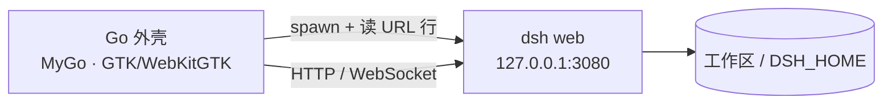

# DSH GTK

把 DeepSeek Harness（`dsh`）装进 [MyGo](https://github.com/egoist/mygo)：一个 Go
桌面外壳，启动 `dsh web`，用原生窗口显示它的工作区。

- 启动时由 Go 进程拉起 `dsh web --no-open --host 127.0.0.1 --port <端口>`，
  从它打印的 `dsh web: <URL>` 里拿到带启动 token 的地址，换取会话 cookie，
  再在 MyGo 窗口里加载工作区。dsh 的会话、模型、插件、工具全部照常工作。
- 单实例：再次启动会把已有窗口提到前面。
- 菜单：重载 / 强制重载 / 缩放 / 开发者工具 / 在浏览器打开 / 重启服务 /
  打开日志 / 打开数据目录。
- 退出（关窗、⌘Q、SIGTERM）时先请 dsh 退出，再把整个进程组收掉，不留后台
  agent。
- 打包：`mygo build` 产出单个 Go 二进制；dsh 运行时和 Node 解释器放在
  `resources/runtime`，作为资源随包分发。



## 目录

```
main.go                     窗口、菜单、生命周期、启停 dsh
internal/dsh/discover.go    找 dsh 运行时：env → 打包目录 → PATH
internal/dsh/server.go      启动 dsh web、解析 URL 行、日志、进程组收尾
internal/warmup/warmup.go   页面加载时的滚动预热（低帧优化，见「性能」）
internal/titlebar/titlebar.go 窗口 chrome 的 GTK CSS：圆角、顶栏、标题按钮
cmd/perfh/main.go           滚动手感测量 harness（开发用，不随应用打包）
web/splash.html             启动页（mygo:// 前端，自带 bridge）
web/error.html              启动失败的诊断页：错误、日志路径、重试/退出
resources/icon.png          应用图标
mygo.json                   MyGo 应用配置（打包用）
scripts/prepare-runtime.sh  把 dsh + Node + npm 灌进 resources/runtime
scripts/make-rpm.sh         把 build 的产物打成 RPM（用 rpmbuild）
packaging/rpm/dsh-gtk.spec.in  上面那个脚本填的 spec 模板
packaging/desktop/dsh-gtk.desktop.in  桌面入口模板（图标、StartupWMClass 等）
third_party/deepseek-harness 拉取的 dsh 源码（tag dsh-v0.2.2-alpha.3，仅作对照/升级参考）
.github/workflows/          CI（push/PR 跑检查）与 Release（tag 出包）
CHANGELOG.md                版本记录
LICENSE                     MIT
```

## 依赖

- Go 1.27.3+
- Linux：GTK 3 与 WebKitGTK 4.1（Fedora：`gtk3 webkit2gtk4.1`；Debian/Ubuntu：
  `libwebkit2gtk-4.1-0`）
- Node：dsh 声明 `>= 24.9.0`。开发时可先用系统 Node；打包脚本自带 Node
  24.11.0。

## 快速开始

四种 dsh 来源，按优先级选用：

1. `--dsh` / `DSH_GTK_DSH`：指向 `lib/bin.js` 或可执行的 `dsh`；
2. `dsh-gtk runtime install` 装好并由 `runtime use` 选中的运行时；
3. `resources/runtime`：`scripts/prepare-runtime.sh` 写出的自包含运行时；
4. `PATH` 上的 `dsh`（例如 `npm install -g @deepseek-ai/dsh`）。

```sh
# 取一份与运行时同版本的 dsh 源码（可选，供对照/升级）
make dsh-src

# 用系统已装的 dsh 直接跑
go run . --workspace ~/code

# 或者先打包运行时（首次约 4 分钟，约 900 MB + Node），再跑
make runtime
go run .
```

启动后先显示启动页，dsh 就绪后窗口切到它的 Web UI。启动失败会显示诊断页，
可以直接重试、打开日志或退出。

## 打包

```sh
make runtime        # resources/runtime：dsh 0.2.2-alpha.3 + Node 24.11.0 + npm 11.6.1
make build          # dist/<平台>-<架构>/ 下的应用（含 resources/runtime）
make rpm            # 再加一个 .rpm（需要 rpmbuild：dnf install rpm-build）
```

`mygo build` 的输出在 `dist/<平台>-<架构>/`，会把 `resources/` 整个复制进
应用。`resources/runtime` 不进 Git
（见 `.gitignore`），所以克隆后先 `make runtime`。

- 只要 dsh 的 JS 包、不要自带 Node：`scripts/prepare-runtime.sh --no-node`，
  运行时回落到 PATH 上的 `node`。
- 换 dsh 版本：`scripts/prepare-runtime.sh --version 0.2.1-rc.5`，再改
  `README`/`third_party` 的对照版本。
- `resources/runtime` 是为**当前系统与架构**准备的：npm 装的是本机可选依赖，
  Node 也是本机二进制。要给另一个平台打包，就在那个平台上各跑一次
  `prepare-runtime.sh` 和 `mygo build`。
- 产物约 1.1 GB（7 万个文件）；`mygo build` 会先暂存到 `dist/.staging-*`，
  再生成安装包，第一次要几分钟。
- `make rpm` 在这之后跑 `scripts/make-rpm.sh`：读 `mygo.json`（名字、版本）和
  `package.json`（SPDX 许可证），把应用连同运行时装进 `/opt/dsh-gtk`，命令
  链接到 `/usr/bin/dsh-gtk`，再装上 `.desktop`、hicolor 图标和许可证。它只
  依赖 `rpmbuild`（Fedora `rpm-build`，Debian/Ubuntu `rpm`），产物落在同一个
  `dist/linux-<架构>/` 目录里。

## 安装

`make build` 在 `dist/<平台>-<架构>/` 下给出三种装法：

```sh
# Debian / Ubuntu
sudo apt install ./dist/linux-amd64/dsh-gtk_0.1.0_amd64.deb

# 任意发行版：解压后由 install.sh 装到 ~/.local（可在应用内更新运行时）
tar xzf dist/linux-amd64/dsh-gtk-0.1.0-linux-amd64.tar.gz
./install.sh dsh-gtk-0.1.0-linux-amd64.tar.gz

# Arch：用产出的 PKGBUILD
cd dist/linux-amd64 && makepkg -si

# Fedora / RHEL
sudo dnf install ./dist/linux-amd64/dsh-gtk-*.rpm
```

装完直接 `dsh-gtk`（或从应用菜单启动）。应用只监听 `127.0.0.1`，并在启动时
用一次性 token 换回本机 cookie，不开放端口给外部。

`install.sh` 把应用装到 `~/.local/dsh-gtk.app`、命令装到 `~/.local/bin/dsh-gtk`，
并在应用菜单里建一项；`sh install.sh --uninstall` 可卸载（保留设置与数据）。

卸载（Debian 包）：`sudo apt remove dsh-gtk`。

## 桌面集成

装好之后它就是一个普通的桌面应用：

- **应用菜单**：`/usr/share/applications/dsh-gtk.desktop`，`Icon=dsh-gtk`（hicolor
  256/512），带 `StartupWMClass=dsh-gtk` 让 GNOME 把窗口和入口归到一起、任务栏
  显示图标，`Keywords` 让概览里搜得到，`SingleMainWindow=true`。
- **托盘**：启动后常驻通知区（StatusNotifier/AppIndicator），菜单里能显示窗口和
  退出，关窗口之后还能从托盘叫回来。桌面没有托盘宿主、或系统没有
  `libappindicator3` 时只是日志里记一句，不影响窗口。
- **窗口**：GTK 自己的标题栏、图标和 WM class，Wayland 下 `app_id` 就是
  `dsh-gtk`，和 desktop 文件同名。

RPM 里的 desktop 文件由 `packaging/desktop/dsh-gtk.desktop.in` 生成；`.deb` 和
`.tar.gz` 里目前还是 MyGo 生成的最小版本（Type/Name/Exec/Icon/Categories），
等上游把 `StartupWMClass` 之类加进 `mygo build` 再统一。

## 发布

CI 在 `.github/workflows/ci.yml`：每次 push / PR 跑 gofmt、`go vet`、`go test`、
`go build`（不需要 GTK 或运行时，单元测试不开窗口）。

发版：

```sh
make check                 # 本地先过一遍 CI 的检查
make release VERSION=0.1.1 # 改 mygo.json 的版本、提交、打 tag v0.1.1
git push --follow-tags     # 推送后 Release workflow 建 draft release
```

打包元数据取自 `mygo.json`（名称、标识、版本、分类），SPDX 许可证取自
`package.json`（Arch 的 PKGBUILD 用），所以两处都要在改版本/换许可证时一起看。

`.github/workflows/release.yml` 在 `v*` tag 上按架构分别构建（`ubuntu-latest`
出 amd64、`ubuntu-24.04-arm` 出 arm64）：**运行时是按架构原生安装的，不能
交叉打包**，所以每个架构都在自己的 runner 上跑 `make runtime` 再
`go tool mygo build`，再跑 `scripts/make-rpm.sh`，生成的 `.deb`、`.rpm`、
`.tar.gz`、`install.sh` 直接挂到 draft release 上，由你确认后发布。

## 参数

| 参数 | 环境变量 | 默认 | |
|---|---|---|---|
| `--workspace` | `DSH_GTK_WORKSPACE` | 用户主目录 | dsh 的工作目录 |
| `--home` | `DSH_GTK_HOME` | dsh 自己的 `~/.dsh` | 传给子进程的 `DSH_HOME` |
| `--port` | | `3080` | 首选端口；`0` 让系统挑 |
| `--dsh` | `DSH_GTK_DSH` | 见上文 | dsh 入口 |
| `--node` | `DSH_GTK_NODE` | 打包的 node → PATH | JS 入口的解释器 |
| | `DSH_GTK_DMABUF` | `auto` | `1`/`on` 强制 WebKit DMABUF 渲染器，`0`/`off` 强制软件渲染；见「性能」 |
| | `DSH_GTK_NPM` | 打包的 npm | `runtime install` 用的 npm CLI（`npm-cli.js`） |
| | `DSH_GTK_WARMUP` | 开 | `0`/`off` 关闭页面加载时的滚动预热；见「性能」 |
| | `DSH_GTK_TITLEBAR` | 开 | `0`/`off` 不注入窗口 chrome 的 GTK CSS，用 GTK 3 原样；见「标题栏」 |

首选端口被占用时（例如另一个 `dsh web` 正跑在 3080），外壳会在启动前先挑
两个备用端口，按顺序试。注意 Web UI 的 origin 会随端口变化，`localStorage` /
IndexedDB 里的界面状态会按新 origin 重新开始。

## 标题栏

官方 Desktop（`apps/desktop`）的做法是按平台分：**macOS** 用 `hiddenInset` +
红绿灯（`trafficLightPosition: {x:16,y:18}`）和内嵌 vibrancy；**Windows** 用
`titleBarStyle: 'hidden'` + `titleBarOverlay`（高 40px，颜色取侧栏填充
`#f9fafb`/`#1b1b1c`，由渲染进程用 canvas 量出真实主题色后经 IPC 同步）；
**Linux 保持系统原生窗口**，不做任何自绘顶栏。Electron 在 Linux 上就是 GTK
窗口，标题、按钮、圆角都交给桌面。

这个外壳照 Linux 的做法：**不画任何页面顶栏**，窗口用 GTK 自己的标题栏，
标题自动跟着页面标题（MyGo 把 `document.title` 同步成窗口标题），按钮是
`gtk-decoration-layout` 决定的真 GTK 控件。剩下要补的只是 GTK 3 主题和
GTK 4 的差异，用 GTK 自己的 CSS 做（`internal/titlebar` 的 `GtkCSS`，经
`mygo.Theme.SetGTKCSS` 以 GTK user priority 加载）：

- `decoration { border-radius: 12px }`：窗口圆角从 GTK 3 的 8px 改成
  libadwaita 的 12px，并去掉 GTK 3 那圈 1px 描边；最大化/全屏/平铺归零，
  菜单/tooltip 保持各自圆角；
- 顶栏改成 libadwaita 的平面：去掉渐变、边框和内高光，底色用 dsh 侧栏
  token（浅 `#f9fafb`、深 `#1b1b1c`），标题粗体、颜色跟主题，和页面连成
  一整块——这正是官方 Windows caption 取色的同一组 token；
- 标题按钮改成 libadwaita 的 24px 圆形、3px 间距、中性 hover
  `alpha(currentColor, .1)`、失焦半透明；
- 菜单栏藏起来（GTK 3 的 menubar 不属于 GTK 4 的观感），Alt / F10 仍能叫出。

因为窗口不再是网页的一部分，标题栏的菜单按钮和「信任 origin 才能调 bridge」
那套也一并去掉了：页面只负责内容，栏上的东西全部是 GTK 的。`DSH_GTK_TITLEBAR=0`
可以关掉这层 CSS 和下面的透明窗口，看未修饰的 GTK 3 原样。

### 下面两角

GTK 3 只圆上面两角，`border-radius` 调多大都没用：`gtk_window_draw()` 按
`decoration` 的半径画背景和阴影，然后把内容区当**实心矩形**再画一层，子控件
（WebKit 视图）盖上去，从不按圆角裁剪子控件。把窗口用 `gtk_widget_draw` 渲染
成图片量过：上面两角 alpha 是 11→21→241→255 的渐变（被裁），下面两角直接
255（直角），加不加 `border-radius` 都一样。所有 GTK 3 应用都这样，Electron
的官方 Linux 版也一样。

所以下面两角由页面自己圆：窗口开 `Transparent`（RGBA visual、WebKit 背景
透明），注入的脚本给 `html/body/#root` 加 `border-radius: 0 0 12px 12px` 和
`overflow: hidden`，角落就透出桌面；GTK 的阴影和圆角背景仍在窗口外层，边缘
干净。最大化/全屏时窗口贴着屏幕边，圆角会露出桌面，所以窗口状态一变就发
`dgo:rounded` 事件，页面把那两角改回直角；重新加载后 `OnDOMReady` 会按当前
状态再发一次。

### 跟随系统深浅色

GTK 3 不读 GNOME 的 `org.gnome.desktop.interface color-scheme`：深色桌面里
GTK 3 应用仍按浅色绘制，WebKitGTK 的 `prefers-color-scheme` 也就一直是
light，dsh 的「跟随系统」外观跟着错，标题栏、启动页、整个工作区都是白的。
外壳在启动时和每次外观变化时，用 `mygo.Theme.SetSource("system")` 把
portal 里的配色写进 GTK 的 `gtk-application-prefer-dark-theme`（GTK 3 和
WebKitGTK 认的就是这个），再补一条：桌面没有 portal 偏好、但 GTK 主题本身
是 `*-dark` 时强制深色。之后 GNOME 设置里切换深浅色，窗口、标题栏、dsh 的
界面会一起变，不需要重启。

启动日志会打印 `dsh-gtk: appearance: dark` / `light`，便于确认读到的值。

App 的菜单（File / Edit / View / Server / Window）在 `AutoHideMenuBar` 下默认
收起，按 Alt 或 F10 叫出来；菜单项和快捷键一直有效，Server → Restart 之类不
受标题栏影响。

首选端口被占用时仍会改用随机端口重试，此时 Web UI 的 origin 会变，
`localStorage` 里的界面状态按新 origin 重新开始。

## 独立更新运行时

dsh 的 JS 树可以装在应用之外、单独升级，不必重新打包应用。应用自带 Node 和
npm（`resources/runtime/node`、`resources/runtime/npm`），`runtime` 子命令在
终端里完成下载、校验、切换：

```sh
dsh-gtk runtime status                  # 当前选择、随包版本、node/npm、上次检查
dsh-gtk runtime check                   # 问 npm：channel 上是否有更新
dsh-gtk runtime check --channel alpha   # 跟 alpha 通道
dsh-gtk runtime check --cached          # 只看上次结果，不联网
dsh-gtk runtime check --exit-code       # 有更新时退出码 10，便于脚本
dsh-gtk runtime install latest          # 下载并选中最新版
dsh-gtk runtime install --no-activate 0.2.1-rc.5
dsh-gtk runtime use 0.2.1-rc.5          # 选中已安装的版本
dsh-gtk runtime rollback                # 回到上一个
dsh-gtk runtime off                     # 回到随包运行时
dsh-gtk runtime remove 0.2.1-rc.5       # 删除已安装的一个（不能是 active）
dsh-gtk runtime prune --keep 1          # 只留 active/previous + 1 个
```

装好后在应用里 **Server → Restart**（或下次启动）生效，菜单里也能直接用
Rollback / Use Bundled Runtime / Open Runtime Folder。菜单 **Server → Check
Runtime Updates…** 会联网检查当前 channel，有更新时弹窗让你 Install：安装在
后台进行（通知 + 日志），完成后提示重启服务。

- 更新检测：`runtime check` 用内置 npm 的 `npm view @deepseek-ai/dsh dist-tags`
  （沿用你的 registry、代理与认证配置），比较当前运行时（已选或随包）与
  `DSH_GTK_CHANNEL`（默认 `latest`，也可 `next`/`alpha`）的版本，结果缓存到
  `~/.config/DSH GTK/runtime-update.json`；`status` 只读缓存，不联网。版本比较
  是完整 semver（含 prerelease），所以 `0.2.2-alpha.3` 不会被 `latest` 的
  `0.2.1-rc.5` 误判为可更新。
- 没有后台自动轮询；检查由菜单、`runtime check` 或你自己的定时任务触发。
- 布局：`~/.config/DSH GTK/runtimes/dsh-<版本>/`，选择写在
  `~/.config/DSH GTK/runtime.json`（`active` / `previous`）。安装先写临时目录、
  验证 `<node> …/lib/bin.js --version` 与 `engines.node`，再原子重命名；npm
  缓存放在 `~/.config/DSH GTK/npm-cache`。
- Node 跟着应用走，运行时不重复打包 node；单个运行时约 900 MB，用 `prune`
  控制占用。
- 兼容性：dsh 还要求比内置 Node 更新的版本时，安装会拒绝并提示更新应用；
  developer preview 期间其它破坏性变更仍可能发生，`runtime rollback` /
  `runtime off` 是回退路径。
- 供应链：npm 按 registry 的 integrity 校验，应用不额外签名；需要更强保证时
  固定版本，并保留随包运行时作为回退。

## 性能

滚动 dsh 的网页时，瓶颈在 WebKitGTK 的**渲染路径**，不在 dsh 服务端。用同一段
4,586 个 DOM 节点的会话、每帧 `scrollTop += 24px` 连续滚动 12 秒测得：

| WebKit 渲染器 | 窗口 | FPS | WebProcess CPU | UI 进程 CPU |
|---|---|---|---|---|
| 软件（MyGo 默认，DMABUF 关闭） | 1600×1000 | 11–19 | 99%（单核打满） | 24–28% |
| 软件 | 2880×1482 | 26 | 99% | 28% |
| DMA-BUF | 1600×1000 | 56 | 49% | 48% |
| DMA-BUF | 2880×1482 | 57 | 51% | 50% |

WebKitGTK 的 DMA-BUF 渲染器在 NVIDIA、虚拟机和容器里会白屏，所以 MyGo 默认关
掉它，由应用显式打开。外壳用 `mygo.App.SetDMABUFRenderer(mygo.DMABUFRendererAuto)`：
在 Wayland + Mesa GPU、且不在容器/虚拟机/NVIDIA 上时保持开启，其余回落软件
渲染；默认值就是 `auto`。

- `DSH_GTK_DMABUF=1` 强制开启（X11 下实测会白屏，慎用），`0` 强制关闭；
- 外部已设的 `WEBKIT_DISABLE_DMABUF_RENDERER` 优先，MyGo 不会覆盖它；
- 启动日志会打印 `dsh-gtk: web renderer: auto (DSH_GTK_DMABUF)`，便于确认请
  求的是哪个策略。

### 滚动预热

dsh 的消息流是懒渲染的：长会话第一次把最后一段滚进视口时，WebKit 要在同一
帧里补上它的布局、绘制和代码块高亮。同一段 4,586 节点的会话、1600×1000、
12 秒连续滚动测得：

| | 1% low | 最长一帧 | >50 ms 的帧 |
|---|---|---|---|
| 原样 | 48 ms | 213 ms | 1 |
| 预热后 | 22 ms | 26 ms | 0 |

（DMA-BUF 渲染器；软件渲染下同一尖峰约 0.9 s，预热后剩约 0.2 s。）

外壳在窗口的 `PreloadScript` 里注入一小段脚本：等 dsh 用
`data-conversation-scroll` 标出的滚动容器出现、内容长到可以滚动之后——

- 会话已经停在末尾（dsh 打开会话的常态）：把滚动位置挪 2px 再挪回来，让
  dsh 装在这些块上的 IntersectionObserver 跑一遍，懒渲染的代价就落在加载
  时，用户看不出位置变化；
- 打开时不在末尾：跳到底部停一帧再回到原位，把最后一段先布局、绘制并高亮。

脚本每个页面只跑一次，只作用于 http 页面（启动页/错误页是 `mygo://`），没
有可滚动的会话时什么都不做。`DSH_GTK_WARMUP=0` 关闭。

代价是每页加载多一次布局/绘制：DMA-BUF 上约 0.2 s，软件渲染约 0.9 s，发生
在窗口刚显示、还没开始滚动时。它也只覆盖加载时打开的那段会话，应用内切换
会话不会重新预热（dsh 是单页应用，没有重新加载页面）。

其它测量结论：

- 空闲时 WebProcess 只占 1–2%，卡顿只在滚动时出现：不是 dsh-pet 之类的动画
  循环在持续重绘。
- 去掉 `backdrop-filter` 后 FPS 55.4 vs 56.4，几乎无差别：模糊不是瓶颈。
- 同一时段 dsh 的 node 进程占 11–17% CPU；它跑会话投影/插件，和滚动流畅度
  无关，但长会话下内存值得关注（WebProcess ~400 MB，node ~200–480 MB）。
- 给消息块加 `content-visibility: auto` 反而更差（滚动高度变化，单帧
  426 ms）；`contain: layout paint` 没有收益。要继续压单帧成本，得在上游把
  消息列表做成虚拟列表，或把代码块高亮改成按需分帧。

## 运行机制

- **登录的一次性处理**：启动页在 `mygo://` 源上，从它跳到
  `http://127.0.0.1:<port>` 是跨站导航；dsh 用 `SameSite=Strict` 的 cookie
  校验会话，浏览器不会在这种导航里带上它，窗口会停在 401 纯文本页。所以
  外壳先自己 `GET` 带 token 的 URL，从 303 响应里取出 `Set-Cookie`，用
  `mygo.Cookies` 以 `SameSite=Lax` 写进窗口会话（只对 loopback 生效），再
  加载根地址。dsh 重启后换 cookie 名，旧名会被清掉。
- 子进程的 `PATH` 会把打包 Node 所在目录放在最前，dsh 再拉起的辅助进程也
  用同一个解释器。
- dsh 的输出（stdout/stderr）逐行写进日志：
  `mygo.App.Path(PathLogs)/dsh.log`（Linux 为
  `~/.config/DSH GTK/logs/dsh.log`），菜单「Server → Open Logs」直接打开。
  启动 URL 里的**一次性 token 在写日志前被打码**（`token=…`），错误页上的
  诊断输出同样处理：日志的生命周期比服务端长，不该留下能登录的凭据。
- Unix 上子进程放进独立进程组，退出时先对进程组发 `SIGTERM`，5 秒后
  `SIGKILL`。Windows 上 node 没有可捕获的终止信号，直接结束进程。
- 外部链接默认交给系统浏览器；窗口内只加载 `127.0.0.1` 上的 dsh。

## 测试

```sh
go test ./...
```

覆盖：`dsh web:` URL 行解析、运行时发现优先级、启动失败时的输出回传、
`EADDRINUSE` 识别、停止子进程、滚动预热的开关与脚本守卫、标题栏脚本的
的关键约定、窗口 chrome CSS 的圆角/顶栏/按钮尺寸与两套深浅配色。

## 已知限制

- Linux 的窗口是 WebKitGTK，不是 Chromium/Electron；dsh 的 Web UI 若依赖
  Chromium 私有行为，可能有个别差异（开发者工具菜单可直接排查）。
- 打包体积大：dsh 的依赖树约 900 MB，加 Node 后更大；这是把完整 agent
  运行时装进应用的成本。
- `third_party/deepseek-harness` 是 `make dsh-src` 拉的浅克隆源码，不参与
  构建；构建用的是 npm 上同版本的发布包（`0.2.2-alpha.3`）。

## 许可证

本仓库的代码是 MIT，见 [LICENSE](LICENSE)。

打包产物里还包含第三方组件，各自遵循自己的许可证：

- **dsh**（`@deepseek-ai/dsh` 及其依赖树，`resources/runtime/node_modules`）：
  按 npm 包里附带的许可证分发，运行时会随 `dsh-gtk runtime` 更新；
- **Node.js**（`resources/runtime/node`）：MIT 与它自带的第三方声明；
- **MyGo**（`github.com/egoist/mygo`）：MIT。

`resources/runtime`、`dist/`、`third_party/` 都不进 Git，发布产物由 CI 现打。
